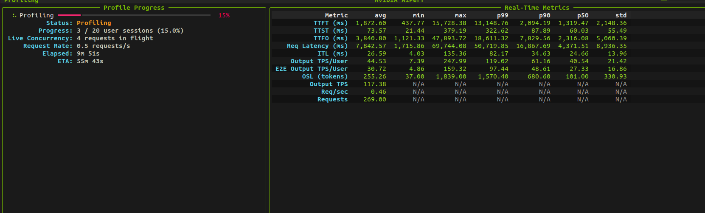

## 1. Findings for config_1 in this iteration of experimentation.

- I used 20 conversations (815 requests) from https://huggingface.co/datasets/sammshen/lmcache-agentic-traces.
- For agentic workload, TTFT and ITL has to be optimized.
- Currently the scheduling policy is fcfs and cache eviction policy is lru. KV Cache offloading is not done(It'd add e2e latency is what I think)
- From the aiperf library, the benchmark run gave some interesting metrics.

  - Concurrency was set to 10.
  - TTFT p50:1.3s, p99:4.4s (pretty bad)
  - ITL p50: 37.44ms, p99: 58.20ms
  - kv_cache_usage_perc avg: 27.26%, max: 65.4%, p50: 26.9% (interesting)
  - prefix_cache_hit_rate : ~96% (good to know)

## 2. Findings for config_2:

- Same GPU and dataset. This run completed 20 conversations (815 requests) at concurrency 20.
- Used quantized model: Qwen3.5-4B-AWQ-BF16-INT4, quantized kv cache on top of config_1
- The metrics are a horror story:-

  - TTFT p50:1.6s, p99: 8.7s, max: ~11s (gotta debug the cause of this.)
  - ITL p50: 48.64ms, p99: 131.91ms, max: 208.60ms.
  - KV cache occupancy: 11.09% average, 7.28% p50, 44.39% peak.
  - Prefix cache hit rate: 95.24% of queried tokens (20,030,080 hits / 21,031,713 queries, using counter deltas to exclude earlier traffic).

- Compared with config_1, mean server queue time rose from 31ms to 377ms and mean prefill time from 378ms to 730ms. Server-generated throughput fell from 100.51 to 97.67 tokens/s (2.8% lower). Average KV cache occupancy fell by 16.18 percentage points, while token-level prefix hit rate went from 95.89% to 95.24%. This run doubled concurrency and changed weights, KV dtype, and attention backend, so it cannot isolate any one change.

## 3. Config 2 rerun at concurrency 10

The rerun attempted the same number of conversations and requests as config_1. Only **244 of 815 requests succeeded (29.9%)**. There were 569 HTTP 503 responses (`no upstreams available`) and two connection resets. AIPerf did not export server metrics for this rerun.

| AIPerf metric | Config 1 (815 successes) | Config 2 rerun (244 successes) |
| --- | ---: | ---: |
| TTFT p50 | 1.31s | 1.46s |
| TTFT p99 | 4.42s | 34.97s |
| ITL p50 | 37.45ms | 25.09ms |
| ITL p99 | 58.20ms | 423.39ms |

Median ITL was **33.0% lower among successful requests**, but tail latency was worse and 70.1% of requests failed. The rerun also omitted `--use-server-token-count`, which affects ITL's token denominator. This is a promising median signal, but there is no confirmed end-to-end inference speedup. Repeat with server token counting enabled after resolving the 503s.

Sources: [Config 1](results/v1/agentic_traces_50_conv/profile_export_aiperf.json), [Config 2 at concurrency 20](results/v2/agentic_conv_20/server_metrics_export.json), [Config 2 at concurrency 10](results/v2/agentic_conv_20_c_10/profile_export_aiperf.json).

## 4. Config 3 run 1 at concurrency 10

With concurrency 10, it seems queuing takes a big chunk out of latency. So stopped it. 

## 5. Config 3 run 2 at concurrency 5
yeah looks no good to me, for num_speculative_tokens: 12

## 6. Config 3 run 3 at concurrency 5

Completed **815 streaming requests across 20 conversations** with DFlash proposing 4 tokens per step. Aggregate throughput was **84.40 output tokens/s** and **0.35 requests/s**.

| AIPerf metric | Mean | p50 | p90 | p99 |
| --- | ---: | ---: | ---: | ---: |
| Time to first token (TTFT) | 1.39 s | 1.27 s | 1.63 s | 4.95 s |
| Time to second token (TTST) | 57.46 ms | 51.07 ms | 74.23 ms | 274.48 ms |
| Time to first output token (TTFO) | 2.93 s | 2.03 s | 5.64 s | 13.17 s |
| Request latency | 6.02 s | 3.50 s | 13.23 s | 31.11 s |
| Inter-token latency (ITL) | 20.19 ms | 19.41 ms | 26.91 ms | 35.58 ms |
| Output throughput per user (tokens/s) | 52.87 | 51.52 | 69.88 | 92.57 |
| End-to-end output throughput per user (tokens/s) | 34.92 | 32.49 | 51.46 | 66.90 |
| Output sequence length (tokens) | 241.32 | 105.00 | 570.60 | 1,576.18 |

The run used AIPerf's client-side token counts and concurrency 5. Config 1 used server token counts and concurrency 10, so a matched rerun is needed to isolate DFlash's effect.

[AIPerf export](results/v3/agentic_conv_20_c_5_d_4/profile_export_aiperf.json)

## 7. config_4 at concurrency 5

Completed **815 streaming requests across 20 conversations** using AWQ INT4 weights, INT8 KV cache, and DFlash with 4 speculative tokens. Aggregate throughput was **88.58 output tokens/s** and **0.37 requests/s**.

| AIPerf metric | Mean | p50 | p90 | p99 |
| --- | ---: | ---: | ---: | ---: |
| Time to first token (TTFT) | 1.57 s | 1.40 s | 2.13 s | 4.20 s |
| Time to second token (TTST) | 71.06 ms | 38.19 ms | 203.93 ms | 404.92 ms |
| Time to first output token (TTFO) | 2.93 s | 2.11 s | 5.23 s | 14.36 s |
| Request latency | 5.27 s | 3.36 s | 11.09 s | 24.43 s |
| Inter-token latency (ITL) | 16.48 ms | 15.32 ms | 23.27 ms | 39.13 ms |
| Output throughput per user (tokens/s) | 67.91 | 65.29 | 96.87 | 121.98 |
| End-to-end output throughput per user (tokens/s) | 39.62 | 36.43 | 62.54 | 85.57 |
| Output sequence length (tokens) | 242.57 | 105.00 | 574.00 | 1,591.10 |

AIPerf reported an output sequence length mismatch warning and collected no GPU telemetry.

[AIPerf export](results/v4/agentic_conv_20_c_5_d_4/profile_export_aiperf.json)

